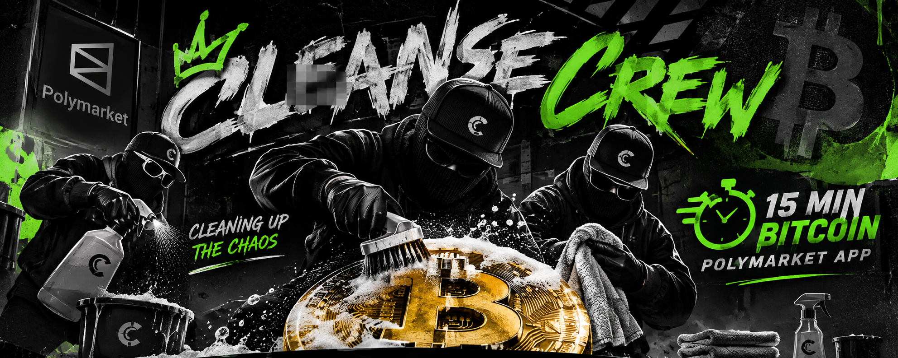

# BTC-Edge



Autonomous multi-timeframe (5m / 10m / 15m) prediction-market trading engine for
Bitcoin. Trades Polymarket (`btc-updown-*`) and Kalshi (`KXBTC15M`) binary
contracts using a regime-aware, fee-aware strategy stack, a self-learning
probability ensemble, and a paper-first safety architecture.

---

## Quick start (plain English — 3 steps)

1. **Run it:**
   ```bash
   .venv\Scripts\activate
   python scripts/run_engine.py
   ```
2. **Open it:** go to **http://localhost:8080** in your browser.
3. **Read it:** the dashboard tells you, in plain English, what the bot thinks,
   how much is at risk, and when it wants to add or pull money. Big **RESUME** /
   **HALT** buttons stop everything instantly.

> **It starts in PAPER mode.** Nothing is traded with real money until you
> deliberately flip it to live (two separate switches, on purpose).

## The two buttons (what each does)

- **▶ RESUME** — clears the emergency halt and lets the bot trade again.
- **■ HALT (KILL SWITCH)** — immediately stops all trading. This is your panic
  button. It also writes a kill-switch file on disk, so even if the web server
  crashes and restarts, it stays halted.

## "Put money in / pull money" (what the bot tells you)

The dashboard shows a plain-English **advice** line plus the **news tone** and
**regime**. It never promises a direction — it tells you whether the bot is
currently inclined to *add* risk (signals bullish) or *reduce* risk (signals
bearish or high volatility). You are always in control of the actual money.

## Features

- **Data ingestion** — Coinbase BTC-USD ticks with a sub-second 60s rolling BRTI
  settlement proxy, Bybit funding/OI/liquidations, Deribit DVOL/ATM IV, Kalshi
  REST+WS, Polymarket Gamma discovery + CLOB.
- **Feature layer** — Window Delta (5x-7x weighted), Black-Scholes `N(d2)`
  option-implied probability, CLOB book imbalance, micro-acceleration, and a
  serializable Deep Pattern Builder (AND/OR boolean rule trees).
- **News intelligence & self-healing filter** — async Bitcoin-news scraper (RSS/Atom),
  financial sentiment analysis (`[-1, +1]` score via a domain lexicon, with an
  optional HuggingFace transformer backend), and a self-healing "brain" that tracks
  per-source predictive accuracy against price settlements, autonomously
  downgrading/disabling noisy sources and promoting them back on recovery.
- **Strategies** — Late-Window Certainty Scalp, Post-Only Market Making, Final
  5-Minute Confluence Trend, and Deribit IV Option-Pricing Arb.
- **Fee-aware backtester** — exact Polymarket `0.07 * p * (1-p)` and Kalshi
  quadratic taker fees, maker fees `0.0`, 5-share Polymarket minimum, top-of-book
  depth caps, and taker latency slippage.
- **Self-learning** — online logistic regression + LightGBM ensemble, nightly
  grader with trailing-200-window Net EV / Win Rate / Brier / Sharpe and automatic
  `PAPER_ONLY_QUARANTINE` of losing strategies.
- **Safety** — paper-first default, dual live gate, 30s-disconnect emergency
  flush, kill switch, 5% daily-loss circuit breaker, Quarter-Kelly (10% cap).
- **Dashboards** — FastAPI web UI (dark institutional) + PySide6 desktop panel +
  browser fallback with a mandatory >$50 confirmation gate.

## Project layout

See `MASTER_SPEC.md` for the full directory tree and component specifications.
Progress is tracked in `PROGRESS.md`.

## Branding

The dark + neon-green brand assets are generated from the canonical `banner.png`
at the repository root:

- `src/btc_edge/web/static/banner.png` — full-width dashboard banner (synced copy).
- `src/btc_edge/web/static/favicon.png` / `favicon.ico` — web favicons.
- `src/btc_edge/web/static/app-icon.png` — desktop app icon.

Regenerate (or re-sync a new banner) with:

```bash
python scripts/generate_branding.py
```

## Requirements

- Python 3.11+
- Windows / Linux / macOS

## Installation

```bash
python -m venv .venv
# Windows
.venv\Scripts\activate
# macOS / Linux
source .venv/bin/activate

pip install -e ".[dev]"          # core + dev tooling
pip install -e ".[desktop]"      # optional PySide6 desktop panel
```

## Configuration

`config/config.yaml` holds all runtime parameters. `trading.mode` **must default
to `"paper"`**. Copy `.env.example` to `.env` and fill in credentials.

### Kalshi API keys

1. Log in to [kalshi.com](https://kalshi.com) -> Account -> Developer/API.
2. Generate an **Ed25519** or **RSA** key pair (start with a **Demo** key).
3. Export the credentials:

   ```bash
   export KALSHI_ACCESS_KEY_ID="<your-access-key-id>"
   export KALSHI_PRIVATE_KEY="<PEM-or-base64-private-key>"
   export KALSHI_USE_DEMO="true"   # demo host
   ```

   Requests are signed with `f"{timestamp_ms}{method}{path}"` (query params are
   stripped before signing) and authenticated via `KALSHI-ACCESS-KEY`,
   `KALSHI-ACCESS-SIGNATURE`, and `KALSHI-ACCESS-TIMESTAMP` headers.

### Polymarket API keys

1. Fund a Polygon wallet.
2. Export the wallet address and EVM private key:

   ```bash
   export POLYMARKET_WALLET="0x..."
   export POLYMARKET_PRIVATE_KEY="0x..."
   ```

## Running

```bash
# 1. Bootstrap 600 historical/synthetic windows (offline-safe)
python scripts/run_bootstrap.py --synthetic-if-offline --windows 600

# 2. Run the fee-aware backtest across all 4 strategies
python scripts/run_backtest.py --historical-dir data/historical

# 3. Start the live engine (paper mode by default)
python scripts/run_engine.py

# 4. Open the dashboard
#    http://localhost:8080

# 5. (Optional) native desktop panel
python scripts/run_desktop.py

# 6. (Optional) fetch + score Bitcoin news sentiment
python scripts/run_news.py

# 7. (Optional) evaluate your old 4-week prediction log (forward test)
python scripts/import_predictions.py your_predictions.csv
```

## The AI assistant (ChatGPT or DeepSeek)

The dashboard has a read-only "Ask the AI" button. It explains what the bot is
doing in plain English. It is **read-only by design** — it can never place or
cancel a trade.

To turn it on, set one environment variable in `.env` (or Render):

```bash
# ChatGPT
AI_API_KEY=sk-...            AI_BASE_URL=https://api.openai.com/v1   AI_MODEL=gpt-4o-mini
# DeepSeek
AI_API_KEY=sk-...            AI_BASE_URL=https://api.deepseek.com/v1  AI_MODEL=deepseek-chat
```

Without a key it still works, using a built-in plain-English summary.

## Go live 24/7 on Render (one click)

`render.yaml` is already in the repo. To deploy always-on:

1. Push this folder to a **GitHub** repo.
2. On [render.com](https://render.com): **New → Blueprint** → point it at the repo.
3. Render reads `render.yaml` and creates a web service with a health check and a
   persistent disk. It is already **paper-first** (`ALLOW_LIVE_TRADING=FALSE`).
4. Add your secrets in **Dashboard → Environment**: `AI_API_KEY`,
   `KALSHI_API_KEY_ID`, `KALSHI_PRIVATE_KEY`, `POLYMARKET_PRIVATE_KEY`, and
   `TELEGRAM_BOT_TOKEN`/`TELEGRAM_CHAT_ID` (for phone alerts).

> **Security rule:** create **trade-only API keys** (no withdrawal permission) on
> both Kalshi and Polymarket. The dashboard shows a green "trade-only keys ✓"
> badge. Never give the bot a key that can withdraw.

## Paper -> Live transition

1. Run in **paper mode** for 5-7 days and confirm your trailing-200-window
   paper Net EV is positive (see `BACKTEST_VALIDATION_REPORT.md` and the nightly
   grader output).
2. Inspect fee impact: Post-Only maker orders and strict Window Delta filters
   usually retain the real edge; taker fees on near-certain scalps are punitive.
3. Set `trading.mode: "live"` in `config/config.yaml` **and**
   `export ALLOW_LIVE_TRADING=TRUE`. **Both** checks must pass before any live
   order is routed. Any single check failing keeps the engine in paper mode.

## Testing

```bash
pytest          # full suite
ruff check .    # lint
mypy src        # static types
```
